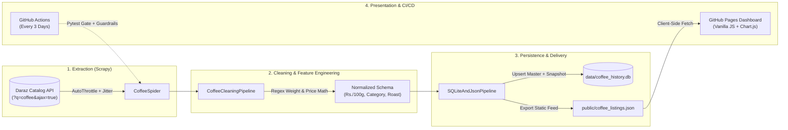

<div align="center">

# ☕ Daraz Nepal Coffee Market Intelligence

**Automated ETL Data Pipeline, Historical Price Warehouse & Interactive Market Analytics Dashboard**

[](https://github.com/YOUR_USERNAME/daraz_coffee_scraper/actions)
[](https://www.python.org/)
[](https://scrapy.org/)
[](https://www.sqlite.org/)
[](https://YOUR_USERNAME.github.io/daraz_coffee_scraper/)

**[🚀 View Live Interactive Dashboard](https://YOUR_USERNAME.github.io/daraz_coffee_scraper/)** · **[📊 Raw JSON Feed](https://YOUR_USERNAME.github.io/daraz_coffee_scraper/coffee_listings.json)**

</div>

---

## 📖 Overview

E-commerce coffee listings across Nepal vary wildly in package sizes (from 25g single-serve sachets to 1kg bulk bags), mixed non-consumable accessories (frothers, mugs, grinders), and unstructured storefront metrics (`"Rs. 1,499"`, `"1.3K sold"`), making true price-per-gram comparison impossible manually.

**Daraz Nepal Coffee Market Intelligence** solves this with a fully automated, zero-cost data engineering pipeline. Every 3 days, a scheduled GitHub Actions runner executes unit tests, crawls Daraz Nepal's catalog API, cleans and normalizes unit economics (**`Rs. / 100g`**), persists historical snapshots into a relational **SQLite** database, and deploys a static **Chart.js** analytics dashboard to **GitHub Pages**.

---

## 🏗️ System Architecture



---

## ⚡ Key Engineering Highlights

* **Direct API Ingestion (Zero Browser Overhead):** Queries Daraz's paginated JSON catalog endpoint (`&ajax=true`) directly rather than spinning up heavy headless browsers, reducing runtime and memory footprint while respecting rate limits via `AutoThrottle` and randomized request jitter.
* **Regex-Driven Feature Engineering:**
  * Strips noise and hardware accessories (mugs, French presses, electric frothers, grinders) using compiled regex filters.
  * Parses package weights across mixed units (`g`, `gm`, `grams`, `kg`) to compute standardized **`price_per_100g`** unit economics.
  * Classifies SKUs into product formats (`Whole Beans`, `Ground Coffee`, `Instant`, `3-in-1 / Premix`, `Drip Bag`) and roast profiles (`Light`, `Medium`, `Medium-Dark`, `Dark`).
* **Idempotent Historical Warehouse (`SQLite`):** Enforces `UNIQUE(item_id, scraped_date)` constraints with `ON CONFLICT DO UPDATE` upserts—guaranteeing safe re-runs without duplicate records while tracking `first_seen`, `last_seen`, `price_change`, and `sold_delta` over time.
* **Self-Healing CI/CD Guardrails:** GitHub Actions runs `pytest` before every crawl and validates minimum record counts (`>= 20` items) prior to committing. If an upstream anti-bot challenge ever returns an empty response, the pipeline aborts cleanly and preserves the last known good dataset on the live site.
* **Zero-Backend Static Analytics:** The frontend parses `coffee_listings.json` directly in the browser for sub-millisecond search, multi-criteria sorting, category filtering, and dynamic Chart.js visualizations with zero server hosting costs.

---

## 🗄️ Data Warehouse Schema & Sample Output

### SQLite Relational Schema (`data/coffee_history.db`)

```sql
CREATE TABLE products (
    item_id      TEXT PRIMARY KEY,
    name         TEXT,
    seller       TEXT,
    location     TEXT,
    coffee_type  TEXT,
    roast_level  TEXT,
    weight_grams INTEGER,
    link         TEXT,
    image        TEXT,
    first_seen   TEXT,
    last_seen    TEXT
);

CREATE TABLE daily_snapshots (
    id             INTEGER PRIMARY KEY AUTOINCREMENT,
    item_id        TEXT,
    scraped_date   TEXT,
    price          REAL,
    original_price REAL,
    discount_pct   INTEGER,
    price_per_100g REAL,
    sold           INTEGER,
    rating         REAL,
    reviews        INTEGER,
    UNIQUE(item_id, scraped_date),
    FOREIGN KEY(item_id) REFERENCES products(item_id)
);
```

### Enriched JSON Payload (`public/coffee_listings.json`)

```json
{
  "item_id": "1001",
  "name": "Himalayan Arabica Medium Roast Coffee Beans 500gm",
  "price": 1500.0,
  "price_display": "Rs. 1,500",
  "original_price": 2000.0,
  "discount_pct": 25,
  "weight_grams": 500,
  "price_per_100g": 300.0,
  "sold": 1300,
  "sold_display": "1.3K sold",
  "rating": 4.86,
  "reviews": 42,
  "coffee_type": "Whole Beans",
  "roast_level": "Medium",
  "seller": "Nepal Roasters",
  "location": "Bagmati Province",
  "scraped_date": "2026-11-22",
  "price_change": 0.0,
  "sold_delta": 14
}
```

---

## 📂 Repository Structure

```text
daraz_coffee_scraper/
├── .github/
│   └── workflows/
│       └── daily_scrape.yml         # Scheduled 3-day CI/CD pipeline & GitHub Pages deploy
├── coffee_scraper/
│   ├── coffee_scraper/
│   │   ├── spiders/
│   │   │   └── coffeespider.py      # Paginated Daraz catalog API spider
│   │   ├── pipelines.py             # Regex cleaning, unit normalization & SQLite/JSON export
│   │   └── settings.py              # Scrapy throttling & pipeline configuration
│   └── scrapy.cfg
├── data/
│   └── coffee_history.db            # Persistent SQLite historical snapshot database
├── public/
│   ├── index.html                   # Portfolio analytics dashboard (Vanilla JS + Chart.js)
│   └── coffee_listings.json         # Latest cleaned dataset served to the frontend
├── test/
│   └── test_pipeline.py             # Pytest unit tests for regex, unit math & deduplication
├── .gitignore
├── requirements.txt
└── README.md
```

---

## 🛠️ Local Development & Testing

### 1. Clone & Set Up Virtual Environment
```bash
git clone https://github.com/YOUR_USERNAME/daraz_coffee_scraper.git
cd daraz_coffee_scraper

python -m venv venv
# Windows PowerShell:
.\venv\Scripts\Activate.ps1
# macOS / Linux:
source venv/bin/activate

pip install -r requirements.txt
```

### 2. Run Unit Tests
```bash
pytest -v
```

### 3. Execute the ETL Pipeline
```bash
cd coffee_scraper
scrapy crawl coffee_spider
```

### 4. Launch Local Dashboard Preview
```bash
cd ..
python -m http.server 8080 --directory public
```
Open **`http://localhost:8080`** in your browser to explore the dashboard.

---

## 👤 Author

**Abhinab**
* GitHub: [@YOUR_USERNAME](https://github.com/YOUR_USERNAME)
* LinkedIn: [linkedin.com/in/YOUR_LINKEDIN](https://linkedin.com/in/YOUR_LINKEDIN)